## 技术栈

## 活动

<picture>
  <source media="(prefers-color-scheme: dark)" srcset="https://raw.githubusercontent.com/shinefuer/shinefuer/output/github-snake-dark.svg" />
  <source media="(prefers-color-scheme: light)" srcset="https://raw.githubusercontent.com/shinefuer/shinefuer/output/github-snake.svg" />
  
</picture>

## 当前关注

- 前缀感知缓存路由的经济学：命中率、TTL 与驱逐策略在合成迹上的近优性边界。
- 级联质量门的校准：置信度阈值、验证器成本与 DP 最优梯度的差距收敛。
- 成本归因方法学：span 守恒性质、缓存节省与批处理折扣的逐任务分解。
